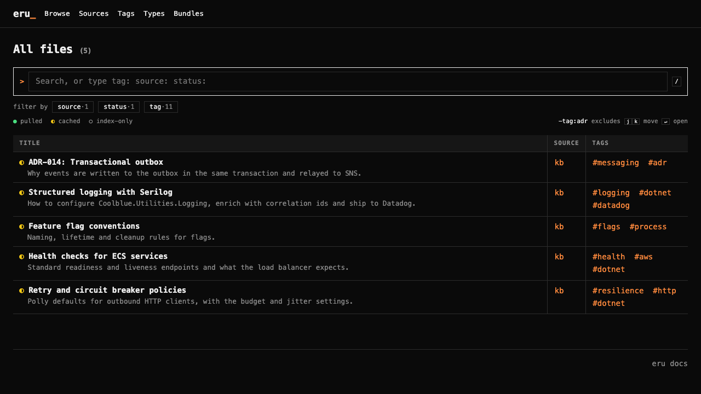

<p align="center">
  
</p>

<h3 align="center">Targeted context for AI agents, from any git repo.</h3>

<p align="center">
  <code>eru</code> pulls just the knowledge an agent needs from local or remote git sources, makes it searchable,
  gives humans a themed site to read it, and lets agents turn a pile of raw notes into a curated knowledge source.
</p>

<p align="center">
  <a href="https://github.com/dburriss/eru/actions/workflows/build.yml"></a>
  <a href="https://www.nuget.org/packages/Eru.Tool"></a>
  <a href="https://github.com/dburriss/eru/releases"></a>
</p>

<p align="center">
  
  <br>
  <sub>The generated site in the <code>terminal</code> theme. See all <a href="docs/reference/theme-list.md">themes</a>.</sub>
</p>

## Get started

Install the tool ([.NET 10](https://dotnet.microsoft.com/download) and [git](https://git-scm.com/) required; self-contained binaries are on the [releases page](https://github.com/dburriss/eru/releases)):

```bash
dotnet tool install --global Eru.Tool
```

Or install a self-contained binary with [mise](https://mise.jdx.dev/), which needs neither .NET nor a separate download:

```bash
mise use --global github:dburriss/eru
```

Install the skill with [skills.sh](https://www.skills.sh/):

```bash
npx skills add dburriss/eru
```

Then ask your agent to set eru up. The skill knows how to add sources, pull files, build a site and run an inbox, so you don't need to learn the commands.

## What it does

### Targeted context for agents

Point eru at one or more git repos, local or remote, and pull only what a project needs: single files, named collections, or everything with a tag. Every pulled file is recorded in a lock file, so it stays in sync and you can see where it came from.

Search is powered by [Ferret](https://github.com/dburriss/ferret): ranked lexical (BM25), semantic and hybrid search, running locally over your knowledge. `eru mcp` exposes that search and retrieval to Claude, Copilot, Cursor and any other MCP client, so agents ask for context instead of reading whole repos.

- [Getting started](docs/tutorials/getting-started.md)
- [Pull files and collections](docs/how-to/pull-files-and-collections.md)
- [Search reference](docs/reference/inspecting-state-and-search.md)
- [Set up the MCP server](docs/how-to/set-up-the-mcp-server.md)

### OKF or an eru manifest

A knowledge source can be an [OKF](https://github.com/GoogleCloudPlatform/open-knowledge-format) bundle, or any repo with an eru `.eru/manifest.json` that declares the files it offers. eru can validate and repair OKF trees, and check that a manifest resolves.

- [Set up a knowledge repo](docs/how-to/set-up-a-knowledge-repo.md)
- [Publish a manifest](docs/how-to/publish-a-manifest.md)
- [Concepts](docs/explanation/concepts.md)

### A site for humans

`eru site generate` builds a self-contained, searchable site from your knowledge, with five built-in themes and room for your own. `eru site serve` adds live reload, and the output publishes straight to GitHub Pages.

- [Site generation reference](docs/reference/site-generation.md)
- [Theme list](docs/reference/theme-list.md)
- [Customize the generated site](docs/how-to/customize-the-generated-site.md)
- [Publish to GitHub Pages](docs/how-to/publish-the-site-to-github-pages.md)

### Agent workflows: from inbox to curated knowledge

Drop raw text into an inbox, which can be a local folder or a remote git repo. An ingestor agent processes each item into well-formed, linked, validated notes in your knowledge source. Run it locally while you work, or in CI so that pushing a raw capture is enough.

- [Use send and watch locally](docs/how-to/use-send-and-watch-locally.md)
- [Process the inbox with a GitHub Agentic Workflow](docs/how-to/generate-docs-from-inbox-with-gh-aw.md)
- [Process the inbox with a plain GitHub Action](docs/how-to/generate-docs-from-inbox-with-a-plain-action.md)

## How it fits together

```
 git repos (local / remote)         inbox (raw text)
   OKF bundle or eru manifest             │
            │                             ▼
            │                     ingestor agent ──▶ curated knowledge
            ▼                                              │
   eru cache + lock file ◀─────────────────────────────────┘
            │
      ┌─────┴───────────────┐
      ▼                     ▼
 agents (search, MCP)   humans (generated site)
```

## Documentation

Full documentation lives under [docs/](docs/README.md), organised by [Diataxis](https://diataxis.fr/): [tutorials](docs/tutorials/README.md), [how-to guides](docs/how-to/README.md), [reference](docs/reference/README.md) and [explanation](docs/explanation/README.md). The complete command list is in the [CLI reference](docs/reference/cli.md).

## Contributing

Run `mise install` for the toolchain, then `dotnet build` and `dotnet test --solution eru.slnx`. CI builds and tests every push and PR; pushing a `v*` tag publishes the NuGet package and GitHub release binaries. See [AGENTS.md](AGENTS.md) for the project layout, conventions and release flow.

## License

[MIT](LICENSE)
