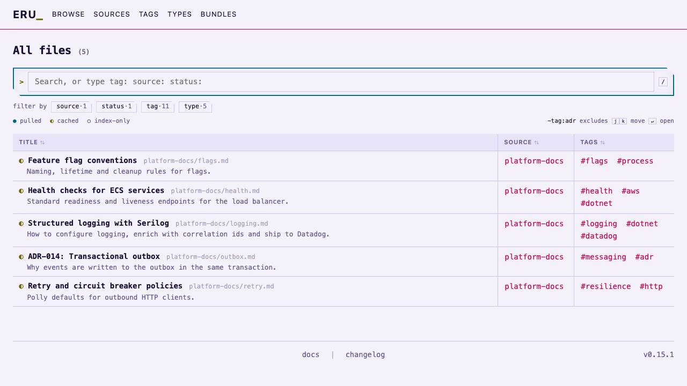
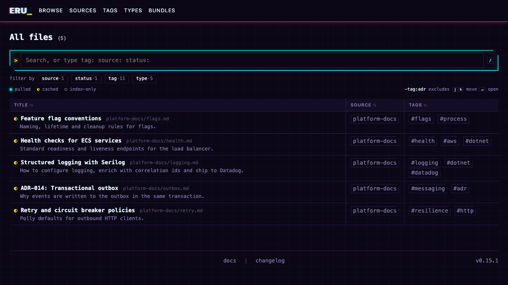

# Theme list

The themes built into `eru site generate`, with a screenshot of the Browse page in light and dark mode. Select one
with `site.theme`; the [site generation reference](site-generation.md#themes) explains how themes layer with your
config and `custom.css`, and [write or install a site theme](../how-to/write-a-site-theme.md) covers custom ones.
`eru theme list` shows these plus any theme installed in `.eru/themes/` or `~/.config/eru/themes/`.

```bash
eru config set site.theme ledger
eru site generate
```

The screenshots show the same five files from one source, so the differences are the theme's alone.

Every theme shares two behaviours, and each recolours them:

- **Filter buttons.** A row's source and tags are bordered buttons that add `source:` or `tag:` to the query line.
  A button fills (the `q-on` class, with `aria-pressed`) while its value is in the query, and the `source`, `status`
  and `tag` key buttons under the query line fill while you type that key. The fill colour is the theme's accent.
  Where a theme turns the query line off, rows show plain tag links instead, since there is nothing to add to.
- **Brand.** The logo at the left of the nav is markup: a link holding `brand-mark`, `brand-name` and `brand-cursor`
  spans, which each theme styles. Replace it with `site.layout.brand`; see
  [replace the logo](../how-to/customize-the-generated-site.md#replace-the-logo).

| Theme | Type | Browse view | Sidebar | Accent |
|---|---|---|---|---|
| [`terminal`](#terminal) (default) | Monospace | Table | None; filters live in the query line | Orange |
| [`ledger`](#ledger) | Sans-serif | Rows | Facets (source, extension, tag, bundle) | Indigo |
| [`matrix`](#matrix) | Monospace | Table | None; filters live in the query line | Phosphor green |
| [`smiley`](#smiley) | Sans-serif | Cards | Facets (source, type, tag) beside the query line | Blue and orange |
| [`cyberpunk`](#cyberpunk) | Monospace, angular display headings | Table | None; filters live in the query line | Magenta, cyan and yellow |

## terminal

Monospace type, square corners, hairline borders and a table of name, source and tags. Filtering happens in the
query line (`tag:`, `source:`, `status:`), and each file's sync state is a glyph before its name (`●` pulled, `◐`
cached, `○` index-only). Active filters fill in orange. The brand is the name followed by a `_` cursor, with no mark.
It is the base stylesheet, so it adds no CSS of its own.

| Light | Dark |
|---|---|
|  |  |

Settings: none (`defaultView` falls back to the Browse table).

## ledger

Dense and quiet: sans-serif type, rounded corners, an indigo accent and one bordered row per file with its
description underneath. The sidebar of checkbox facets does the filtering, so the query line is off and the
plain search box stays; with no query line, tags and sources are plain links rather than filter buttons. Sync state
is a coloured dot. The brand is a small indigo square before the name, with no cursor. If you turn the query line
back on, active filters fill with a soft indigo tint instead of a solid colour. The palette follows the system or the
theme toggle in both modes.

| Light | Dark |
|---|---|
|  |  |

Settings it ships (override any of them in your own `site` config):

```json
{
  "defaultView": "rows",
  "layout": { "left": ["facets"], "toolbar": false }
}
```

## matrix

The terminal layout in phosphor green. Light mode is dark green ink on pale mint. Dark mode is bright green on
near-black, with a faint text glow and scanlines (both dark mode only). Every colour is a shade of green, so sync state
relies on the glyph shapes (`●` `◐` `○`) rather than colour, and active filters invert (green fill, dark text). The
brand is a `>` prompt before the name and a `_` cursor after it. It keeps the terminal's table, query line and glyphs.

| Light | Dark |
|---|---|
|  |  |

Settings: none (`defaultView` falls back to the Browse table). Select it with `eru config set site.theme matrix`.

## smiley

Coolblue blue and orange, with the terminal's query line and a facet sidebar (source, type and tag) beside a grid of cards (one per file, with
its description and tags). A solid blue header band (navy in dark mode) carries white navigation
text and a round orange smiley mark beside the name (no cursor). Orange marks the selected row and active tags, blue
marks the query line and the active filter key. Text is sans-serif, with monospace kept for paths, tokens and keys,
and pills replace square boxes. Cards link their tags to the tag pages rather than adding filters; set
`defaultView: "table"` to get the table back, and the tags become filter buttons again.

| Light | Dark |
|---|---|
|  |  |

Settings it ships (override it in your own `site` config):

```json
{
  "defaultView": "cards",
  "layout": { "left": ["facets"] }
}
```

The `facets` widget has no option to pick facets, so the theme's CSS shows only source, type and tag, in that order,
and hides the file extension and bundle sections. To bring one back or reorder them, override the
`.sidebar-section:has([data-facet="ext"])` rules in `custom.css`; the sections are `source`, `ext`, `tags`, `type`
and `bundle`.

## cyberpunk

The terminal layout in neon magenta, cyan and yellow. Dark mode is deep violet with a faint cyan grid, a magenta glow
under the header and a magenta/cyan split on the name (not on the yellow `_` cursor); light mode is pale lavender with none of those effects.
Magenta marks active things (filled tags, the selected row and option), cyan marks focus, the active filter key and
sync state (`●` pulled), and yellow marks the prompt, the cursor and the `◐` cached glyph. The query box, tokens and filter buttons have clipped corners. It keeps
the terminal's table, query line and glyphs.

Navigation, table headers, popup headings and the name use an angular display face in capitals: Chakra Petch if it is
installed, otherwise Eurostile (macOS), Bank Gothic or Segoe UI Semibold (Windows) or the system sans. Body text stays
monospace. No font is shipped with the site. Light-mode cyan, yellow, orange and magenta are deeper than a pure neon
palette so that text keeps at least 4.5:1 contrast on the lavender backgrounds.

| Light | Dark |
|---|---|
|  |  |

Settings: none (`defaultView` falls back to the Browse table). Select it with `eru config set site.theme cyberpunk`.

## Regenerating the screenshots

The images are 1280 × 720 captures of `index.html` from a site generated with each theme. Set `site.theme` and `site.showSyncStatus: true` (the glyphs are off by default), run
`eru site generate`, and capture the page in a browser at that size. For a mode that does not depend on the
system setting, add `class="theme-light"` or `class="theme-dark"` to the `<html>` element of a copy of the page
and remove its `js/theme.js` script tag before capturing.

The repo has a ready-made sample project for this in [`samples/theme-site`](../../samples/theme-site/README.md); use it so the screenshots stay comparable and never contain real documents.
