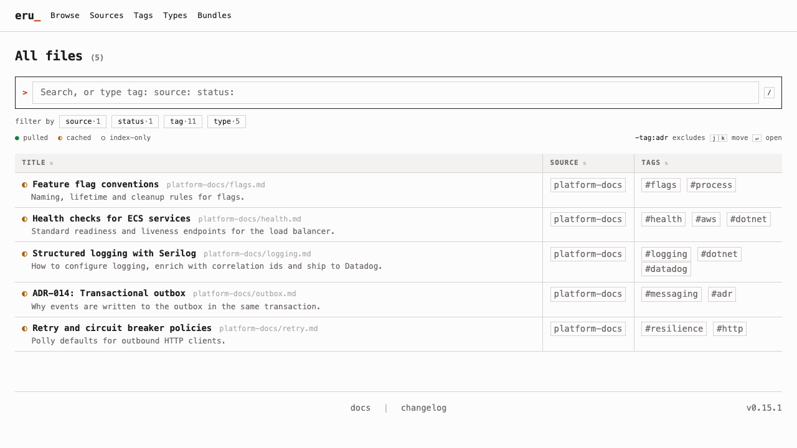
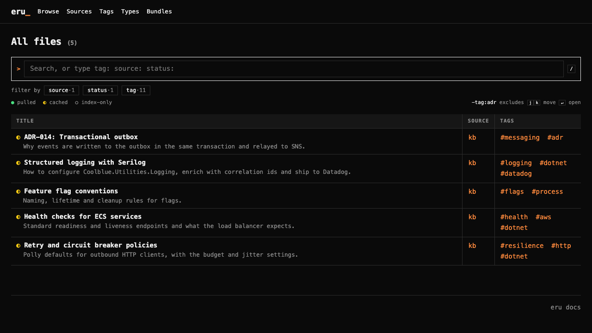
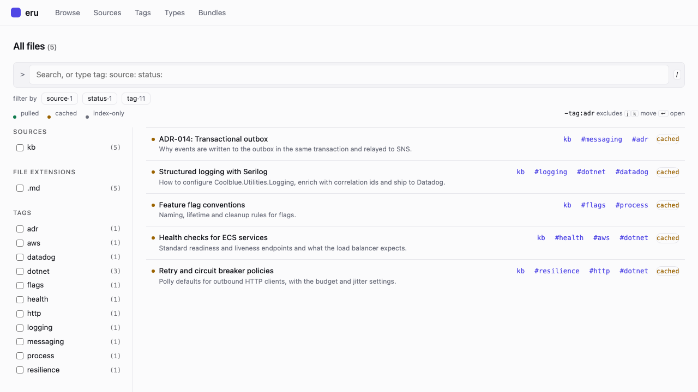
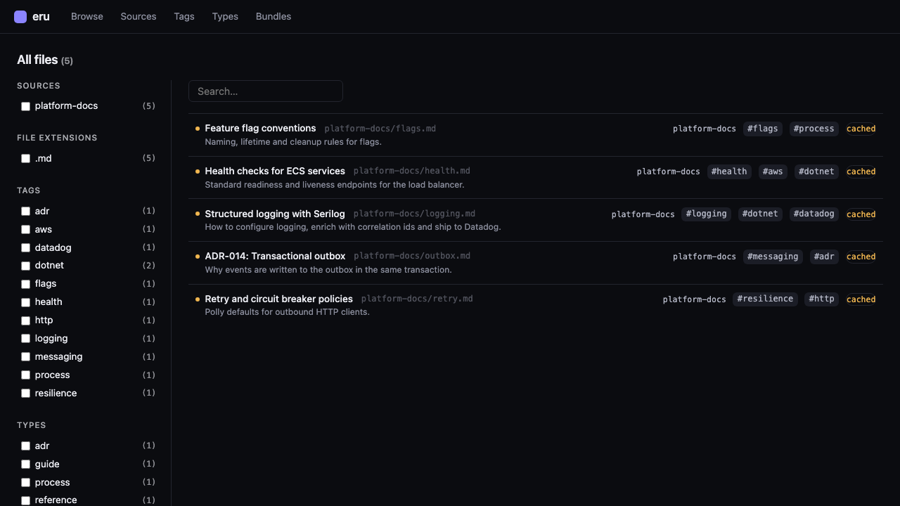
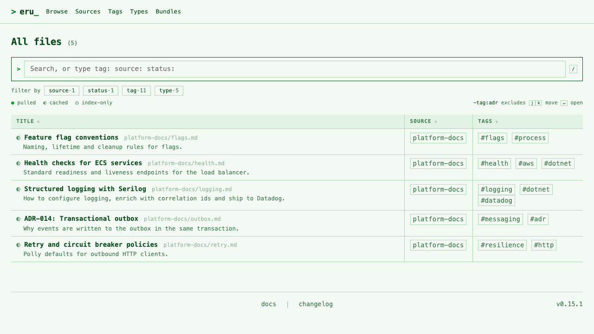
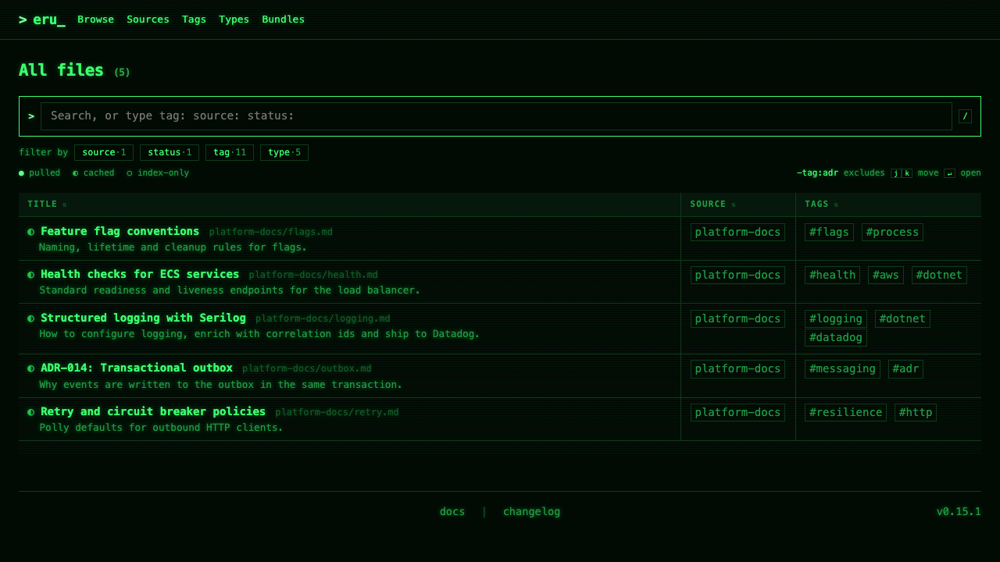
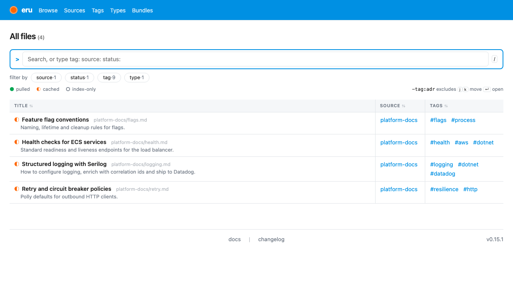
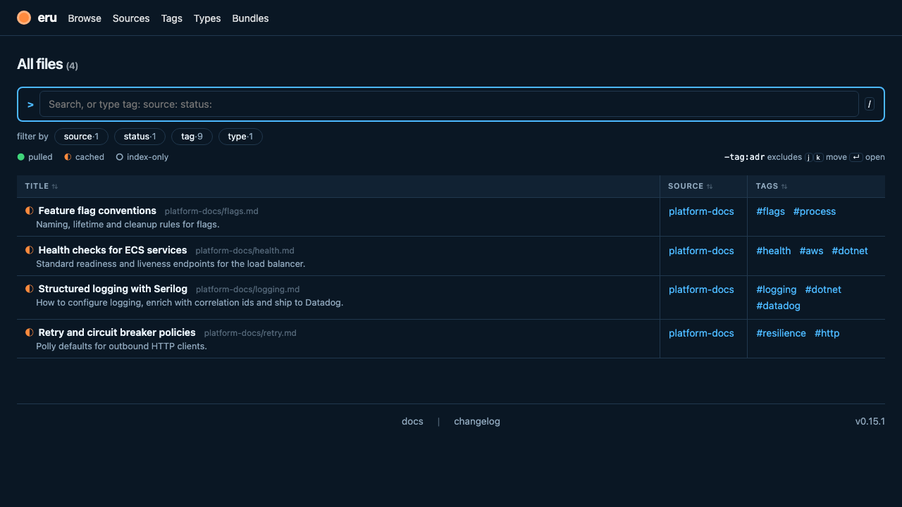

# Theme list

The themes built into `eru site generate`, with a screenshot of the Browse page in light and dark mode. Select one
with `site.theme`; the [site generation reference](site-generation.md#themes) explains how themes layer with your
config and `custom.css`, and [write or install a site theme](../how-to/write-a-site-theme.md) covers custom ones.
`eru theme list` shows these plus any theme installed in `.eru/themes/` or `~/.config/eru/themes/`.

```bash
eru config set site.theme ledger
eru site generate
```

The screenshots show the same five files from one source, so the differences are the theme's alone.

| Theme | Type | Browse view | Sidebar | Accent |
|---|---|---|---|---|
| [`terminal`](#terminal) (default) | Monospace | Table | None; filters live in the query line | Orange |
| [`ledger`](#ledger) | Sans-serif | Rows | Facets (source, extension, tag, bundle) | Indigo |
| [`matrix`](#matrix) | Monospace | Table | None; filters live in the query line | Phosphor green |
| [`smiley`](#smiley) | Sans-serif | Table | None; filters live in the query line | Blue and orange |

## terminal

Monospace type, square corners, hairline borders and a table of name, source and tags. Filtering happens in the
query line (`tag:`, `source:`, `status:`), and each file's sync state is a glyph before its name (`●` pulled, `◐`
cached, `○` index-only). It is the base stylesheet, so it adds no CSS of its own.

| Light | Dark |
|---|---|
|  |  |

Settings: none (`defaultView` falls back to the Browse table).

## ledger

Dense and quiet: sans-serif type, rounded corners, an indigo accent and one bordered row per file with its
description underneath. The sidebar of checkbox facets filters alongside the query line, and sync state is a
coloured dot. The palette follows the system or the theme toggle in both modes.

| Light | Dark |
|---|---|
|  |  |

Settings it ships (override any of them in your own `site` config):

```json
{
  "defaultView": "rows",
  "layout": { "left": ["facets"] }
}
```

## matrix

The terminal layout in phosphor green. Light mode is dark green ink on pale mint. Dark mode is bright green on
near-black, with a faint text glow and scanlines (both dark mode only). Every colour is a shade of green, so sync state
relies on the glyph shapes (`●` `◐` `○`) rather than colour. It keeps the terminal's table, query line and glyphs.

| Light | Dark |
|---|---|
|  |  |

Settings: none (`defaultView` falls back to the Browse table). Select it with `eru config set site.theme matrix`.

## smiley

The terminal layout in Coolblue blue and orange. A solid blue header band (navy in dark mode) carries white navigation
text and an orange dot beside the name. Orange marks the selected row, blue marks the query line and active filters.
Text is sans-serif, with monospace kept for paths, tokens and keys, and pills replace square boxes. It keeps the
terminal's table, query line and glyphs.

| Light | Dark |
|---|---|
|  |  |

Settings: none (`defaultView` falls back to the Browse table). Select it with `eru config set site.theme smiley`.

## Regenerating the screenshots

The images are 1280 × 720 captures of `index.html` from a site generated with each theme. Set `site.theme` and `site.showSyncStatus: true` (the glyphs are off by default), run
`eru site generate`, and capture the page in a browser at that size. For a mode that does not depend on the
system setting, add `class="theme-light"` or `class="theme-dark"` to the `<html>` element of a copy of the page
and remove its `js/theme.js` script tag before capturing.
